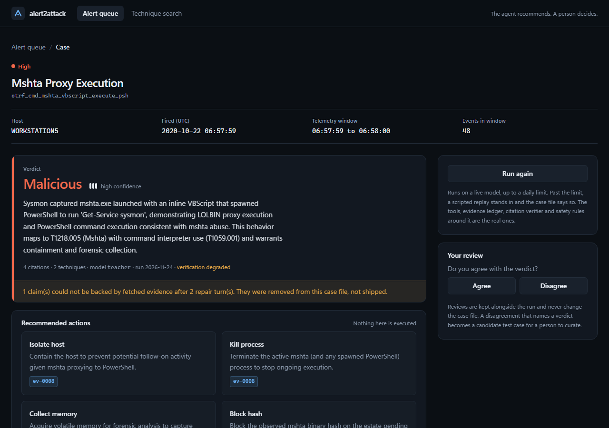
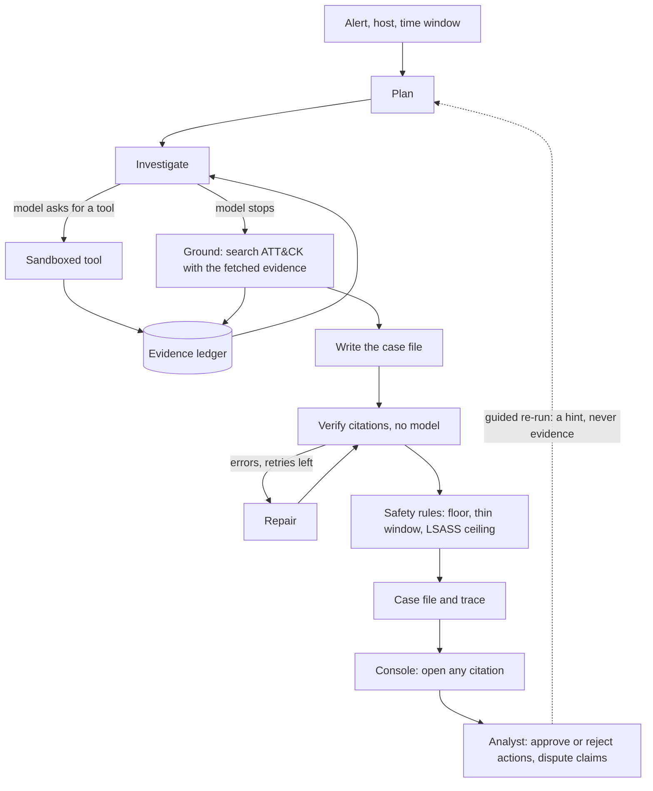

# alert2attack

An investigation agent for EDR alerts. Given one alert and a window of host telemetry, it writes a case file: a verdict, the processes in scope, the ATT&CK techniques, and what a person should do next. Every claim cites an event the agent fetched on that run, and a deterministic verifier removes any claim it cannot back.

It is built to assist an analyst, not replace one. The agent recommends and never acts: every recommended action waits for a person to approve or reject it, any claim can be disputed, and the analyst can re-run a case with what they know that the logs do not show.

- **9 of 10** right verdicts on held-out cases with a local 7B model, up from 5 of 10 before technique grounding, and no recommended action the answer key forbids.
- The hosted `gpt-5-mini` behind the live demo also gets **9 of 10** on the same cases.

**[Live demo](https://alert2attack-demo.ashyisland-fb3eded8.italynorth.azurecontainerapps.io)**: open one of the four finished sample cases and approve, reject or dispute what the agent wrote, or press Run investigation for a live run (about a minute, 20 a day).



Python, LangGraph, FastAPI, React and TypeScript · measured on [OTRF Security Datasets](https://github.com/OTRF/Security-Datasets) · [MIT](LICENSE)

This README is organised around the decisions: what was built, why, and what each choice did to the numbers.

## Contents

- [The problem](#the-problem)
- [Results](#results)
- [Architecture](#architecture)
- [A person in the loop](#a-person-in-the-loop)
- [Design decisions and what each one buys](#design-decisions-and-what-each-one-buys)
- [Technique grounding, in detail](#technique-grounding-in-detail)
- [How the experiments were run](#how-the-experiments-were-run)
- [What is not solved](#what-is-not-solved)
- [Run it](#run-it) · [Console](#console) · [Search](#search) · [Repo map](#repo-map)

## The problem

EDR (endpoint detection and response) products watch laptops and servers and raise alerts: "this process opened LSASS", "this script launched PowerShell". An analyst then has to answer three questions under time pressure. Is it a real attack, a false alarm, or not enough to say? Which processes are in scope? What do we do next?

Two failure modes make this hard to automate:

- **A wrong action is expensive.** Isolating a host because a backup product touched LSASS takes a working machine off the network.
- **A confident fake citation is worse than a slow human.** A general-purpose model given the raw log will cite events it never saw.

So the system is built around two rules. The agent can only read telemetry through tools that record what they returned, and nothing it writes ships unless a program that is not a language model can trace it to that record. The agent recommends. A person decides. It never isolates a host or kills a process itself, and the console treats every recommended action as undecided until an analyst signs it off.

It does not detect anything. Detection already fired; this is the step after.

## Results

Which model runs where:

| Model | Where it runs | Used for |
|---|---|---|
| `qwen2.5:7b-instruct`, 7B parameters | Locally, served by Ollama | The product path, and the model the benchmarks below are built around |
| `gpt-5-mini` (2025-08-07) | Azure OpenAI, EU Data Zone | The live demo, and the third table below. In the code it is the `teacher` model |
| `replay` | No model | The offline console. Never used in evaluation |

What the headline numbers mean:

| Number | Plain meaning | Better is |
|---|---|---|
| Verdict accuracy | Share of cases where the verdict matches the answer key | Higher |
| Mean cost | How bad the misses are, averaged over every case. A right verdict costs 0. Calling a real attack "likely benign" costs 5, "not enough evidence" 3, "suspicious" 1; calling a benign case malicious costs 2 | Lower |
| Citations valid | Share of citations that are real ids fetched on that run | Higher |
| Key-process recall | Whether the processes that matter were named | Higher |
| Action safety | Share of cases with no recommended action the answer key forbids, such as isolating a benign host | Higher |

Three sets of numbers, measured in different places. Tables 1 and 2 are not comparable with each other; table 3 reruns table 2's held-out cases.

**1. The recorded test, 13 held-out cases, cloud T4 GPU.** This is how the system got to its baseline.

| Who ran the investigation | Verdict acc | Mean cost | Citations valid | Key-process recall | Action safety |
|---|---:|---:|---:|---:|---:|
| One prompt, no tools | 0.23 | 1.85 | 0.98 | 0.42 | 0.85 |
| Agent, local 7B, first version | 0.00 | 1.62 | 1.00 | 0.46 | 0.92 |
| Agent, local 7B, with the six graph rules | 0.54 | 1.85 | 1.00 | 0.85 | 1.00 |
| Agent, local 7B, rules plus QLoRA | 0.54 | 0.77 | 1.00 | 0.96 | 1.00 |
| Agent, larger cloud model | 0.54 | 0.77 | 1.00 | 0.85 | 1.00 |

**2. Technique grounding, before and after, same machine and model.** The latest change, measured as a pair on a laptop GPU.

| | Dev, 18 cases | | Held-out test, 10 cases | |
|---|---:|---:|---:|---:|
| | Off | On | Off | On |
| Verdict accuracy | 0.39 | **0.72** | 0.50 | **0.90** |
| Mean verdict cost | 1.94 | **0.61** | 1.30 | **0.30** |
| Technique F1 | 0.04 | **0.27** | 0.05 | **0.45** |
| Action safety | 1.00 | 1.00 | 1.00 | 1.00 |
| Citations valid after verification | 1.00 | 1.00 | 1.00 | 1.00 |
| Key-process recall | 0.89 | 0.83 | **1.00** | 0.75 |
| Tool calls per case | 5.9 | 10.5 | 5.5 | 9.5 |

Read the second table with its limits in mind: one run per arm, small samples, and 28 of the 33 scenarios (see [Technique grounding, in detail](#technique-grounding-in-detail)). The direction is consistent across dev and test; the exact figures will move on a re-run.

**3. The same 10 held-out cases on the demo's hosted model.** Grounding on, one run each. The 7B column is the "On" test column above.

| | Local 7B | `gpt-5-mini` |
|---|---:|---:|
| Verdict accuracy | 0.90 | 0.90 |
| Mean verdict cost | 0.30 | 0.30 |
| Technique F1 | 0.45 | 0.45 |
| Action safety | 1.00 | 1.00 |
| Citations valid after verification | 1.00 | 1.00 |
| Citations valid before verification | 0.88 | 1.00 |
| Key-process recall | 0.75 | 1.00 |
| Cases with an acceptable recommended action | 0.40 | 0.90 |
| Tool calls per case | 9.5 | 12.7 |

The hosted model does not get more verdicts right. Each model misses one real attack by answering "not enough evidence", and it is a different case each time: the logon-script persistence case for the 7B, the audit-policy change for `gpt-5-mini`. Where the hosted model is ahead is the rest of the case file: it names the key processes and recommends an acceptable action far more often, and it uses about a third more tool calls to get there. With 10 cases and one run, the tie on verdicts is the finding, not the decimals. Report: [`docs/experiments/2026-11-24-grounding-test-on-gpt5mini.json`](docs/experiments/2026-11-24-grounding-test-on-gpt5mini.json).

## Architecture

The agent is a LangGraph graph: named steps, edges and one loop. The model sits inside some steps. The graph decides the order, when to stop, and which deterministic rules run after the model writes.



| Step | What happens | Model involved |
|---|---|---|
| Plan | Sketch hypotheses and first questions | Yes |
| Investigate | A tool loop. Eight tools: open the alert, walk the process tree, search events, read the Sigma rule, look up a technique, decode PowerShell | Yes |
| Evidence ledger | Every successful fetch stamps its ids. If an id is not in the ledger, it does not exist for this case | No |
| Ground | Search ATT&CK using the alert and the events already fetched, then look up the top five hits so they enter the ledger | No |
| Write | Fill the case-file schema from the ledger digest and tool summaries | Yes |
| Verify and repair | Check every citation, process id and technique id against the ledger. Two repair turns, then unsupported claims are stripped and the case is marked degraded | Verify: no |
| Safety rules | Three deterministic checks on the verdict and the recommended actions | No |

The answer key never enters the database the agent can query. That boundary is covered by tests, including one that scans every scenario over HTTP.

## A person in the loop

The goal is to help whoever reviews the alerts, not to close alerts without them. The agent writes a case file; a person decides what happens. The console gives that person four ways in, from the whole verdict down to a single line.

| What the analyst does | Where | What happens |
|---|---|---|
| Approve or reject each recommended action | Under every action card | The action shows as pending until someone decides. A rejection needs a reason. The panel counts how many are decided, and nothing in the console is ever executed |
| Dispute one claim | Under every timeline entry and technique | The dispute and its reason show next to the item. This corrects a detail, such as a process that is really the backup agent, without rejecting the verdict |
| Agree or disagree with the verdict | The review panel | A disagreement names the verdict the case should have had |
| Re-run with guidance | Under Run again | The analyst writes what they know that the telemetry does not show, and the agent runs again with it |

Four rules keep this honest:

- **The case file is never edited.** Every decision is a separate, append-only record next to it, so the file stays the record of what the agent said on that run. The latest decision per item is the one shown.
- **A hint is guidance, not evidence.** It reaches the agent's plan fenced and labelled as the analyst's words. The verifier still accepts only ids the agent fetched, so a hint cannot be cited. The new case file says it was a guided run, quotes the hint, and links the run it follows.
- **Disagreements are exported, never written into the dataset.** `GET /reviews/export` and `GET /feedback/export` return them for a person to curate. Letting the agent's own output become its answer key is the contamination the eval protocol exists to prevent.
- **Evaluation never passes a hint.** The numbers in [Results](#results) are unguided runs, and a test checks that an unguided run's prompts contain no guidance.

The API for all four is `POST /investigations/{id}/review`, `POST /investigations/{id}/feedback`, and `POST /investigations` with `guidance` and `follows_job_id`.

## Design decisions and what each one buys

Each row is a choice, the reason for it, and the evidence. Where a choice was not measured, the row says so.

### Investigation and evidence

| Decision | Why | What it bought |
|---|---|---|
| Tools only, no raw log in the prompt | A model handed the whole window cites events that are not there | Against a single prompt on the 13-case test: citation validity 0.98 to 1.00, key-process recall 0.42 to 0.46 on the first version and 0.85 with the graph rules |
| An evidence ledger as the only source of ids | Makes "did the agent actually see this?" a lookup | Citations valid after verification are 1.00 on every agent row in all three tables |
| A deterministic verifier with repair, then strip | A fabricated citation must not ship clean, and a model cannot be the judge of its own citations | With the local 7B, 12 to 17% of citations were invalid before verification on the held-out grounding runs (0.84 to 0.88 valid); after it, none. `gpt-5-mini` started at 1.00 |
| Degraded is a visible state | An analyst should know when claims were removed | The console shows how many claims were stripped and after how many repair turns |

### Verdict and safety

| Decision | Why | What it bought |
|---|---|---|
| Fix the workflow before training the model | The first agent cited real evidence and still never said "malicious". That is a write-step failure, and training cannot fix a rule that runs after the model writes | Six deterministic graph rules took verdict accuracy from 0.00 to 0.54 and action safety from 0.92 to 1.00 with the same untuned model |
| A verdict floor | If the case file already cites a high-severity tactic, "not enough evidence" is the wrong label | Part of the 0.00 to 0.54 move; it only fires on techniques the agent named, which is why grounding mattered later |
| A thin-window ceiling | A sliver of telemetry around the trigger is not a full attack | The truncated "not enough evidence" twins are all correct in every recorded run |
| An LSASS false-positive ceiling | LSASS access without signs of a dump is usually a backup or security product | Action safety 1.00: no benign host gets an isolate recommendation. It costs one real case (see [What is not solved](#what-is-not-solved)) |
| Asymmetric costs in the metric | Calling an attack benign is worse than calling it suspicious | Lets a change be judged by how wrong its misses are, not only how many |

### Technique grounding

| Decision | Why | What it bought |
|---|---|---|
| Propose techniques from evidence, not from the model's memory | A technique reached the case file only if the model guessed its id and looked it up. Technique F1 was 0.04 to 0.05, and the verdict floor needs a named technique | Held-out test: verdict accuracy 0.50 to 0.90, mean cost 1.30 to 0.30, technique F1 0.05 to 0.45. Four cases flipped to correct, none the other way |
| Build the query from fetched events only, and strip ATT&CK ids and Sigma tags from it | Otherwise the search reads the answer off the rule's own label | Keeps the step honest: it can only surface what the telemetry the agent pulled supports |
| Route proposals through the normal lookup tool | The verifier accepts a technique only if its id is in the ledger | Proposals are checked by the same verifier as everything else; citations stay at 1.00 |
| Keep proposals as candidates the write step may reject | Five candidates per case would otherwise all be claimed | Unsupported claims fell (0.66 to 0.36 on test) even though more candidates were offered |
| Lexical search by default | On the full 697-technique catalog, BM25, dense vectors and their fusion were indistinguishable on 17 dev cases (a right technique in the top five for 71% under each) | No embedding model to download or run, and the measured null result is in [`docs/RETRIEVAL_EVAL.md`](docs/RETRIEVAL_EVAL.md) |

### Model and training

| Decision | Why | What it bought |
|---|---|---|
| A local 7B model as the product path | Telemetry stays on the machine and a run costs nothing per token | Matches a larger cloud model on verdict accuracy (0.54 each) on the recorded test, and the demo's `gpt-5-mini` (0.90 each) on the grounding test |
| One QLoRA adapter, trained on dev traces only | To learn whether training adds anything the graph does not | Mean cost 1.85 to 0.77 and key-process recall 0.85 to 0.96. Accuracy did not move |
| A control run without the adapter | The adapter was trained after the graph changed, so its gain was confounded | Showed accuracy and safety came from the graph, and cost and recall from the adapter |
| No rank or learning-rate sweep, no 14B default, no synthetic training events | Each would have added runs without answering an open question | Recorded as rejected ideas in the experiment log |

### Evaluation

| Decision | Why | What it bought |
|---|---|---|
| Real captures, split into dev and test, never tuned on test | 33 scenarios from OTRF: 20 dev, 13 test, including benign lookalikes and truncated twins | The grounding step was built and checked on dev, then run once on test, unchanged |
| A frozen metric module | Changing the ruler mid-project makes every earlier number unreadable | Every row in every experiment uses the same five numbers |
| Paired before/after on one machine | Hardware, context size and quantisation all move the numbers | The grounding table compares like with like; it is not added to the T4 table |
| A no-tools baseline and a larger-model ceiling | To know whether a number is good | Shows the 0.54 ceiling was the workflow, since the larger model hit it too |

### Serving

| Decision | Why | What it bought |
|---|---|---|
| A console where every citation opens the record behind it | The claim "it cites its evidence" should be checkable by a reader in one click | Verdict first, then actions, timeline, techniques and scope, each with its citations |
| A live stream of the run | A local 7B takes one to three minutes; waiting has to be legible | Server-sent events for each phase, tool call and rule |
| A `replay` responder | A reviewer without a GPU can still drive the real tools, ledger and verifier | The console works with no model; replay is never used in evaluation |
| A daily cap on live-model runs | A public demo spends real tokens on each run | Past the cap a run uses replay and the job records that it did |

### Human oversight

| Decision | Why | What it bought |
|---|---|---|
| Every action is pending until a person signs it off | A wrong containment takes a working machine off the network, and the agent is right 9 times in 10, not 10 | Nothing counts as decided by the agent alone. Not measured: no study of how analysts use it |
| Disputes on single claims, not only on the verdict | Most disagreements are about a detail, and rejecting a right verdict over one wrong line loses information | A correction lands on the line it is about, with its reason |
| Append-only decisions beside an unchanged case file | The case file is the only record of what the agent said | Decisions can change without rewriting history, and every one is kept |
| A hint fenced as guidance, routed through the plan | An analyst knows things the logs do not, but a hint must not become a citation | The verifier still checks every claim against fetched evidence. Not measured: whether hints improve verdicts |

## Technique grounding, in detail

**The diagnosis.** On the recorded 13-case test, every miss was a real attack that the agent called "suspicious" or "likely benign". Benign and not-enough-evidence cases were all correct. The larger cloud model had the same accuracy, so the limit was the workflow. The agent named a technique only when the model guessed an id and looked it up, and the rule that raises a verdict to "malicious" only fires on a named technique.

**The change.** One step between investigate and write:

1. Build a query from the alert's rule title and description and from the command lines, images and paths of the events the agent has fetched. ATT&CK ids are scrubbed from it and Sigma tags are never used.
2. Search the technique corpus and take the top five.
3. Look each one up through the normal tool, so it lands in the ledger, the trace and the live stream like any other call.
4. Pass them to the write step as candidates. The model still decides which ones the telemetry supports, and the verifier and safety rules still run afterwards.

It is about 80 lines in [`technique_grounding.py`](src/alert2attack/agent/technique_grounding.py) and is switched on with `ALERT2ATTACK_GROUND_TECHNIQUES=1`. It is off by default so the recorded rows still describe the default graph.

**The protocol.** Built and checked on the dev cases, with nothing tuned after the first dev run. Then run once on test, off and on. Same machine (RTX 4060 laptop GPU), same model (`qwen2.5:7b-instruct`, the digest used for the recorded untuned rows), 4,096-token context.

**Case by case on the held-out test.**

| Case | Answer | Off | On |
|---|---|---|---|
| Audit policy modification | Malicious | Wrong (cost 1) | Correct |
| mshta running VBScript | Malicious | Wrong (cost 1) | Correct, both techniques named |
| SharpView reconnaissance | Malicious | Wrong (cost 3) | Correct |
| Empire VBS launcher | Malicious | Wrong (cost 5) | Correct |
| Logon-script persistence | Malicious | Wrong (cost 3) | Wrong (cost 3) |
| Scheduled task creation | Malicious | Correct | Correct |
| mshta, truncated window | Not enough evidence | Correct | Correct |
| Three benign LSASS cases | Likely benign | Correct | Correct |

On dev, six cases flipped to correct and none the other way; one already-wrong case got a costlier wrong verdict.

**What it costs.** About four more tool calls per case (the lookups), and key-process recall fell on test from 1.00 to 0.75. I have not yet found out why the write step names fewer processes when it has technique candidates in front of it. It looks tied to the model: `gpt-5-mini` with the same candidates keeps key-process recall at 1.00 (table 3).

**Limits of this measurement.**

- One run per arm. A local model is not deterministic across runs, so treat a single case flipping as weak evidence and the overall direction as the finding.
- 28 of the 33 scenarios. The benchmark machine's antivirus removes five scenario files because they contain recorded attack command lines. Three of those are test cases, including the one the LSASS ceiling is known to get wrong.
- The technique search runs over the 30 techniques bundled with the agent. With so few to choose from, the right one is easy to find. On the full 697-technique catalog the top-five hit rate is 71%, so the step should help less there.
- The numbers are not comparable with the recorded T4 table: different hardware, different subset.

The four run reports are in [`docs/experiments/`](docs/experiments/) (`2026-11-13-grounding-*.json`).

## How the experiments were run

Each experiment is one hypothesis, one method, a measured result and a decision. The full log is [`docs/experiments/TRACKER.md`](docs/experiments/TRACKER.md).

| Experiment | Question | Outcome |
|---|---|---|
| EXP-001 | Does the tool loop beat a single prompt? Is a larger model better than the local 7B? | The loop wins on citations and process recall. The local 7B scored 0.00 on verdict accuracy. The larger model sets the ceiling |
| EXP-002 | Is the 0.00 a tools bug, a JSON bug or a write-step problem? | The write step: too conservative, techniques omitted, truncated windows over-called, LSASS false positives. Six graph rules |
| EXP-003 | Can traces from the larger model pass a strict filter and become training data? | Yes, 14 kept, dev only |
| EXP-004 | Does one QLoRA run on the new graph beat the old 7B without hurting safety? | 0.54 accuracy, 0.77 cost, safety 1.00, confounded with the graph change |
| EXP-005 | How much of that was the graph alone? | Accuracy and safety are the graph. The adapter is the cost cut and the extra process recall |
| EXP-006 | Do evidence-grounded technique candidates fix the under-called attacks? | Dev 0.39 to 0.72 and held-out test 0.50 to 0.90, safety unchanged, on a 28-scenario subset |
| EXP-007 | On the same 10 held-out cases, does the demo's hosted `gpt-5-mini` beat the local 7B? | Same verdict accuracy (0.90) and cost; better key-process recall (1.00 vs 0.75) and acceptable actions (0.90 vs 0.40), with more tool calls |

## What is not solved

- **One known wrong case.** `otrf_empire_mimikatz_logonpasswords` is a real credential dump that the LSASS ceiling capped to "likely benign" in the recorded runs. A narrow exception is implemented and unit-tested but has not been re-measured, and the laptop benchmark could not include that case.
- **Technique naming is still weak.** F1 of 0.45 means the agent still names wrong or missing techniques on most cases.
- **Small samples.** 13 recorded test cases, 10 in the grounding pair. Enough to see a workflow failure, not enough for a confidence interval worth quoting.
- **Single host, single alert.** No hunting across hosts, no alert ingestion from a real EDR, no multi-tenancy.
- **The human loop is built, not measured.** No study of whether guided re-runs reach better verdicts, or of how analysts use sign-off. One operator account, no roles. The public demo keeps decisions in memory, and any visitor can click them.
- **A prototype, not a product.** It is measured and it runs, and it is not hardened for a SOC.

## Run it

Offline, with no GPU and no API key (scripted model):

```bash
uv sync
uv run pytest
uv run alert2attack scenarios list
uv run alert2attack tool get_alert --scenario otrf_empire_launcher_vbs
uv run alert2attack investigate otrf_empire_launcher_vbs   --model scripted --responses-json path/to/responses.json
```

With the local 7B (Ollama `qwen2.5:7b-instruct`; set `ALERT2ATTACK_OLLAMA_MODEL=casefile-qlora-n14` for the QLoRA adapter):

```bash
uv run alert2attack investigate otrf_empire_launcher_vbs --model ollama
```

With the hosted model, set `OPENAI_API_KEY` (or `EXPLABS_API_KEY`) and `ALERT2ATTACK_TEACHER_MODEL`, plus `ALERT2ATTACK_TEACHER_BASE_URL` for Azure OpenAI, then pass `--model teacher`.

Evaluate. Reports land in the gitignored `reports/`. The metric module is frozen: do not change `metrics.py`.

```bash
./scripts/smoke_eval.sh --split test --limit 1
./scripts/smoke_eval.sh --live local --split test --limit 3
uv run alert2attack eval run --arm agent-teacher --split test
uv run python scripts/render_eval_table.py reports
```

Serve on localhost only:

```bash
uv run alert2attack serve --host 127.0.0.1 --port 8000
# or the API plus Ollama:
docker compose up --build
```

Compose publishes the API on `127.0.0.1:8000` and Ollama on `127.0.0.1:11434`; do not expose those ports on a public interface. It keeps job records and reviews in a named volume so a case link survives a restart, and the train group is not in the image. Without `CONSOLE_PASSWORD_HASH` the API has no inbound auth, so treat it as a laptop demo. Only the hosted model needs an API key, and that key is outbound.

Checks, as CI runs them:

```bash
uv run ruff check . && uv run mypy
npm --prefix web run typecheck && npm --prefix web run build
uv sync --group retrieval && uv run python -m alert2attack.retrieval.bench --embedder fastembed
```

The full CLI is in [`docs/RUN.md`](docs/RUN.md) and the training extras (`uv sync --group train`) in [`docs/TRAIN.md`](docs/TRAIN.md).

## Console

`web/` is a React and TypeScript console over the agent, built with Vite, TanStack Query, and Tailwind. The design, including what it leaves out on purpose, is in [`docs/DESIGN-console.md`](docs/DESIGN-console.md).

What it does:

- An alert queue over the 33 scenarios, filterable by split, severity, and free text.
- A case view with the alert, its boxed telemetry window, and the case file once an investigation has run.
- A live trace while an investigation runs: the graph phase, each tool and model call as it happens, the evidence ledger filling up, and the graph levers. A lever that looked at the case and declined to act still shows up, because on a benign LSASS alert that is the interesting part.
- Citations you can open. Click `ev-0042` in a claim and the console shows the telemetry event the agent fetched. Rule and ATT&CK citations open the rule or technique. A citation the run never fetched returns a 404 and is shown as unverifiable, since the verifier should already have stripped that claim.
- A search page over ATT&CK techniques. Each hit shows which channel ranked it and where. See [Search](#search).
- Sign-off, disputes, reviews and guided re-runs on every case. See [A person in the loop](#a-person-in-the-loop).

Start the API, then the console:

```bash
uv run alert2attack serve --host 127.0.0.1 --port 8000
```

```bash
npm --prefix web install
npm --prefix web run dev
```

The console is at <http://localhost:5173>. That port is the origin the API allows by default; set `ALERT2ATTACK_CORS_ORIGINS` to change it.

Press Run investigation on any case to run the `replay` model. It is a canned responder that does no reasoning. It exists so the live trace works on a checkout with no Ollama and no API key. The graph, the tools, the ledger, the verifier, and the levers around it are all real, and its output is deterministic, so a recording reproduces. Nothing measured in this README uses it: the eval runner cannot select it, and two tests hold that boundary. A replay run often ends degraded. The graph adds process ids to the scope after the write, and the verifier strips any whose `process_create` the run never fetched. That path does not depend on the model.

No route returns the answer key. `tests/api/test_gold_boundary.py` matches raw response bodies against the gold field names, so a leak through a field nobody typed still fails. It was written before the first route.

The API is open unless you configure sign-in, and it logs a warning at startup when it is. Set `CONSOLE_PASSWORD_HASH` to require a bearer token on the data routes (`/health`, `/metrics`, the sign-in route, and `/me` stay open). Make the hash with `uv run python -m alert2attack.api.auth`. This is demo-grade auth: one operator, one scrypt hash, HS256 tokens from PyJWT, no user table or roles. A real deployment would put the console behind the organisation's identity provider. The browser keeps the token in memory rather than `localStorage`, because the console renders command lines from telemetry that an attacker controls.

The API side has tests for each route above. The React side is typechecked and built in CI but has no browser tests yet. Setup details and environment variables are in [`web/README.md`](web/README.md).

### Public demo image

The `Dockerfile` builds one image that serves the API and the built console from the same origin, and CI publishes it to GHCR from `main`. In that image the Run button asks for a live cloud model instead of `replay`.

| Variable | Purpose |
|---|---|
| `ALERT2ATTACK_WEB_DIST` | Folder holding the built console. Set in the image; unset, the API serves no pages. |
| `ALERT2ATTACK_TEACHER_BASE_URL`, `ALERT2ATTACK_TEACHER_MODEL`, `OPENAI_API_KEY` | The live model: any OpenAI-compatible endpoint, for example an Azure OpenAI deployment's `/openai/v1`. |
| `ALERT2ATTACK_DAILY_LIVE_RUNS` | Cap on live-model runs per UTC day. Past it, runs use `replay` and the job records that. Unset means no cap. |
| `ALERT2ATTACK_RECORDED_RUNS` | A JSON file of finished runs to load at startup with their original ids and dates. The image points it at `datasets/demo/recorded_runs.json`: four live `gpt-5-mini` demo samples on test cases, not part of any evaluation. Three verdicts match the answer key; the Mimikatz credential dump is called suspicious where the key says malicious. |

The cap is counted from the job store, so it resets if the store does. With the default in-memory store that means on every restart; set `ALERT2ATTACK_JOBS_DB` on a persistent volume if the cap has to hold across restarts.

The live demo runs this image on Azure Container Apps with one replica kept warm, so there is no cold start. Deploying is a manual step after CI publishes: point the app at the new `ghcr.io/deimos2002/alert2attack-agent:<commit sha>` tag.

## Search

`src/alert2attack/retrieval` searches ATT&CK techniques three ways: BM25, dense vectors in Qdrant (`bge-small-en-v1.5` through `fastembed`), and the two fused by reciprocal rank. It is an optional install (`uv sync --group retrieval`), and the agent does not use it by default. A test pins the default tool list, and the agent tool `search_attack_techniques` exists only when `ALERT2ATTACK_RETRIEVAL_TOOL=1`.

On the dev split (17 scorable scenarios, 697 techniques) all three methods put a right technique in the top five for 12 of 17, against 0.012 for a random ranking. They cannot be told apart on the pre-registered headline: the paired differences from BM25 in recall@5 and MRR all have intervals containing zero. Dense and hybrid each win two scenarios and lose two, and none of the four that BM25 missed entirely is rescued. Nothing has measured whether the agent tool helps an investigation. [`docs/RETRIEVAL_EVAL.md`](docs/RETRIEVAL_EVAL.md) has the setup, the failures, and three problems in the data found along the way. One is that technique ids sit in the raw telemetry of 5 of the 20 dev scenarios.

The API's search box works on a bare checkout. Without the full ATT&CK catalog at `datasets/raw/attack_catalog.json` it falls back to the 30 techniques vendored with the agent and says so in every response. Dense search is opt in, because it downloads the embedding model (about 64 MB, into the gitignored `datasets/raw/embedder_cache`) on first use:

```bash
uv sync --group retrieval
ALERT2ATTACK_EMBEDDER=fastembed uv run alert2attack serve --host 127.0.0.1 --port 8000
```

Qdrant runs in memory or embedded on disk by default. `ALERT2ATTACK_QDRANT` accepts a server URL too, but that path is untested because the development machine has no Docker.

## Repo map

| If you want... | Open |
|---|---|
| How to install, investigate, eval, serve | [`docs/RUN.md`](docs/RUN.md) |
| Run the console, turn on sign-in, regenerate its types | [`web/README.md`](web/README.md) |
| Console design and trade-offs | [`docs/DESIGN-console.md`](docs/DESIGN-console.md) |
| Retrieval results, failures and data problems | [`docs/RETRIEVAL_EVAL.md`](docs/RETRIEVAL_EVAL.md) |
| Research status / train hold / GPU gates | [`docs/STATUS.md`](docs/STATUS.md) |
| Experiment log (hypothesis to decision) | [`docs/experiments/TRACKER.md`](docs/experiments/TRACKER.md) |
| Optional QLoRA extras | [`docs/TRAIN.md`](docs/TRAIN.md) |
| Teacher-dev distill data card (DR-012 locked) | [`docs/experiments/DATA_CARD-teacher-dev-v0.md`](docs/experiments/DATA_CARD-teacher-dev-v0.md) |
| Design spec | [`docs/design/2026-09-09-edr-investigation-agent-design.md`](docs/design/2026-09-09-edr-investigation-agent-design.md) |
| The 33 OTRF scenarios | [`datasets/scenarios/`](datasets/scenarios/), [`datasets/catalog.yaml`](datasets/catalog.yaml), [`datasets/AUTHORING.md`](datasets/AUTHORING.md) |

### Code layout

- `src/alert2attack/domain`: Pydantic models (events, alert, scenario, evidence ids). No I/O.
- `src/alert2attack/store`: SQLite `CaseStore`; refuses to load gold labels.
- `src/alert2attack/knowledge`: vendored Sigma rules, ATT&CK subset, PowerShell decoder.
- `src/alert2attack/tools`: sandboxed tools + `EvidenceLedger`.
- `src/alert2attack/agent`: LangGraph plan/investigate/ground/write/verify/repair, evidence-grounded ATT&CK candidates (`technique_grounding.py`, opt-in), ledger ATT&CK write candidates, post-verify verdict floor, thin-window NEE abstain, LSASS FP ceiling (DR-013 levers 1-6; DR-017 Option A skip), ChatModel, optional budgets (default unbounded), traces, live progress events (`progress.py`), and the `replay` demo responder (`replay.py`, never used by eval).
- `src/alert2attack/verify`: deterministic citation verifier + degrade.
- `src/alert2attack/eval`: metrics, B0 baseline, arm runner, distillation export.
- `src/alert2attack/api`: FastAPI app with investigations, scenario and evidence routes, an SSE progress stream, analyst reviews, optional single-operator auth, and Prometheus.
- `src/alert2attack/dataset`: OTRF normalizer, window boxing, catalog, build.
- `src/alert2attack/retrieval`: BM25, Qdrant dense search, rank fusion, and a dev-only benchmark. Optional (`--group retrieval`); the agent does not import it.
- `web/`: the console (Vite, React, TypeScript). `web/src/lib/schema.d.ts` is generated from the API's OpenAPI document.
- `scripts/smoke_eval.sh`: offline/live eval smoke; `scripts/render_eval_table.py` merges reports; `scripts/filter_teacher_dev_distill.py` filters teacher-dev JSONL (DR-012 locked); `scripts/prepare_sft_examples.py` / `scripts/train_qlora_sft.py`: N>=12 QLoRA SFT (DR-015); `scripts/lightning_*.sh`: Studio runners (paths via `ALERT2ATTACK_*`, see [`docs/TRAIN.md`](docs/TRAIN.md)).
- `Dockerfile`: one image with the API and the built console. `docker-compose.yml`: that image plus Ollama (7B pull on first start); published ports bound to `127.0.0.1`.
- `.github/workflows/ci.yml`: ruff, mypy, and pytest; the console typecheck and build; and a check that the generated TypeScript types match the API; on `main`, it also publishes the image.
- `reports/`: eval JSON/Markdown outputs (gitignored).
- `datasets/scenarios/<id>/`: `manifest.yaml` + `events.jsonl` (OTRF-only real telemetry).
- `tests/fixtures/scenarios/`: synthetic cases for unit tests only (not part of the dataset).


## License

MIT for this repository's code. Third-party Sigma / ATT&CK data under `src/alert2attack/knowledge/data/` has its own terms; see [`ATTRIBUTION.md`](src/alert2attack/knowledge/data/ATTRIBUTION.md).
